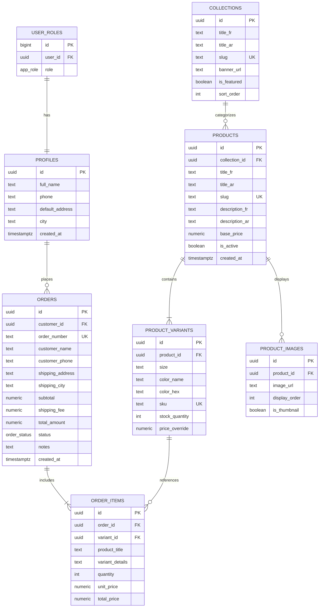

# SAIS Store — Project Brief & Architecture Specification

> **Phase 0 Output: Project Understanding & Technical Feasibility Report**  
> *Target Market:* Morocco (MAD, French & Arabic UI, WhatsApp COD checkout)  
> *Form Factor:* PWA (Native-feeling mobile app + Responsive desktop storefront + Admin back-office)  
> *Date:* November 2026

---

## 1. Project Explanation in Our Own Words

**SAIS Store** is a specialized online boutique for women's clothing, tailor-made for the Moroccan e-commerce landscape. In Morocco, purchasing habits differ significantly from standard Western e-commerce: customers heavily favor **Cash on Delivery (COD)**, require direct conversational trust via **WhatsApp**, and access the web primarily through mobile devices on varying network speeds.

Rather than building disjointed native mobile apps and a separate desktop site, SAIS Store is engineered as a single unified **Progressive Web App (PWA)** codebase with dual adaptive personalities:
1. **On Mobile Devices (Smartphones):** It delivers an uncompromising native app feel inspired by Dipstore aesthetics—deep forest green (`#1B4332`), warm cream/peach backgrounds (`#FFF8F0`), tactile white cards with generous rounded corners, DM Sans typography, a fixed bottom tab bar with safe-area notch awareness, gesture-driven bottom sheets for filters/cart/variant pickers, and smooth 60fps micro-interactions.
2. **On Desktop / Laptops:** It gracefully expands into an elegant, wide-viewport fashion catalog with a sticky top navigation header, multi-column editorial product grids, collapsible facet filter sidebars, quick-view flyouts, and slide-over cart drawers.
3. **Storefront Scroll Experience:** Smooth fluid scrolling via **Lenis** synchronized with **GSAP ScrollTrigger** on a single unified animation ticker (`autoRaf: false`), providing high-end editorial storytelling without frame stutters.
4. **Checkout & Conversion Funnel:** Eliminates friction. When a customer confirms their basket, the order and line items are validated and created server-side in **Supabase** (guaranteeing price integrity and inventory reservation), generating a clean order reference (e.g. `ORD-XXXX`). Immediately upon creation, the user is redirected into an official WhatsApp click-to-chat (`wa.me`) link with a beautifully structured bilingual (Arabic / French) prefilled invoice message ready to send to the boutique's fulfillment agents.
5. **Admin Operations (`/admin`):** A secure, data-dense administrative dashboard (bypassing smooth scroll) where boutique managers authenticate to curate collections, manage SKUs/variants/stock, upload product photos directly into Supabase Storage buckets, and monitor COD fulfillment pipelines.

---

## 2. Final Verified Tech Stack & Exact Versions

All packages verified against official npm registry releases (November 2026):

| Layer / Library | Exact Version | Justification & Architectural Role |
|---|---|---|
| **Framework** | `next@16.4.5` | React Server Components, App Router, Server Actions, `proxy.ts` request boundary |
| **UI Runtime** | `react@19.3.1` | Native Actions, Server Components, useActionState |
| **Language** | `typescript@7.0.2` | Strict type safety, end-to-end schema validation |
| **Styling** | `tailwindcss@4.3.5` | High-performance CSS-first architecture (`@theme`), zero JS config |
| **PostCSS Plugin** | `@tailwindcss/postcss@4.3.5` | Modern PostCSS build pipeline |
| **Smooth Scroll** | `lenis@1.3.27` | Momentum scrolling, `data-lenis-prevent`, unified clock integration |
| **Animation Engine** | `gsap@3.15.1` | Free core & plugins (ScrollTrigger), precision scroll-linked timelines |
| **GSAP React Bindings**| `@gsap/react@2.1.2` | `useGSAP` hook for automated context cleanup & memory leak prevention |
| **Component Animation**| `motion@14.11.1` | Modern successor to `framer-motion` (`motion/react`), spring sheets & tabs |
| **Data Synchronization**| `@tanstack/react-query@5.107.1` | SSR HydrationBoundary, optimistic cart state, infinite catalog pagination |
| **Database & Auth** | `@supabase/supabase-js@2.119.0` | Postgres client, Realtime subscriptions, Storage manager |
| **Server Auth Helpers**| `@supabase/ssr@0.12.7` | Next.js cookie-driven auth sessions across Server Components and Server Actions |
| **Schema Validation** | `zod@4.6.7` | High-speed string parsing, unified `{ error }` syntax, top-level `z.email()` |
| **Form Management** | `react-hook-form@7.91.0` | Uncontrolled high-performance forms with variant array support |
| **Form Resolvers** | `@hookform/resolvers@7.0.5` | First-class Zod v4 resolver compatibility |
| **PWA & Offline** | `@serwist/next@9.5.13` | Actively maintained Next.js App Router service worker builder |
| **Core Service Worker**| `serwist@9.5.13` | Precaching, offline page fallback, runtime asset caching |

---

## 3. Architecture Proposal

### 3.1 Folder Structure
```
f:\sais - store\
├── app/
│   ├── (storefront)/                     # Customer-facing storefront
│   │   ├── layout.tsx                    # Lenis smooth scroll + Motion providers + BottomTabBar/TopNav shell
│   │   ├── page.tsx                      # Landing / Hero / Trending / Featured Collections
│   │   ├── products/
│   │   │   ├── page.tsx                  # Catalog with faceted filtering & infinite scroll
│   │   │   └── [slug]/
│   │   │       └── page.tsx              # Product Detail Page (PDP): gallery, sizes, colors, sticky CTA
│   │   ├── collections/
│   │   │   ├── page.tsx                  # Collections directory
│   │   │   └── [slug]/page.tsx           # Filtered collection view
│   │   ├── cart/
│   │   │   └── page.tsx                  # Full cart view (mobile fallback for drawer)
│   │   ├── checkout/
│   │   │   └── page.tsx                  # COD customer details form (City, District, Phone)
│   │   └── order-success/[id]/
│   │       └── page.tsx                  # WhatsApp redirection handoff screen
│   ├── (admin)/                          # Back-office admin dashboard
│   │   ├── layout.tsx                    # Admin shell (sidebar, metrics, NO Lenis smooth scroll)
│   │   └── admin/
│   │       ├── page.tsx                  # KPI Dashboard (orders, revenue in MAD, pending deliveries)
│   │       ├── products/                 # SKU list, stock status, bulk actions
│   │       │   ├── new/page.tsx          # Multi-image uploader, variant matrix generator
│   │       │   └── [id]/page.tsx         # Product editor
│   │       ├── collections/page.tsx      # Seasonal categories & banner manager
│   │       ├── orders/                   # Order pipeline (Pending → Confirmed → Shipped → COD Received)
│   │       │   └── [id]/page.tsx         # Order details & WhatsApp chat trigger
│   │       └── settings/page.tsx         # Store phone number, shipping fees per Moroccan city
│   ├── (auth)/
│   │   ├── login/page.tsx                # Customer / Admin login
│   │   └── forgot-password/page.tsx
│   ├── api/
│   │   └── webhooks/                     # Async integration hooks if needed
│   ├── ~offline/
│   │   └── page.tsx                      # Serwist PWA offline fallback screen
│   ├── manifest.ts                       # Dynamic Web App Manifest
│   ├── sw.ts                             # Serwist Service Worker source
│   ├── layout.tsx                        # Global root layout (DM Sans font, theme meta tags)
│   ├── globals.css                       # Tailwind v4 `@theme` & design tokens
│   ├── providers.tsx                     # TanStack Query & Motion global configuration
│   └── get-query-client.ts               # SSR-safe QueryClient factory
├── components/
│   ├── ui/                               # Primitives (Button, Modal, Sheet, Badge, Input, Toast)
│   ├── storefront/                       # Storefront widgets (ProductCard, VariantPicker, HeroSlider)
│   ├── admin/                            # Data tables, image dropzones, status badges
│   └── layout/                           # TopNav, BottomTabBar, CartDrawer, MobileSearchSheet
├── lib/
│   ├── supabase/
│   │   ├── client.ts                     # createBrowserClient singleton
│   │   ├── server.ts                     # createServerClient (async cookies())
│   │   └── admin.ts                      # Service-role privileged client (server-only)
│   ├── whatsapp.ts                       # wa.me link generation & UTF-8 formatting helpers
│   ├── formatters.ts                     # MAD currency (new Intl.NumberFormat('fr-MA', ...)), +212 phones
│   └── utils.ts                          # Classnames & misc helpers
├── hooks/
│   ├── useCart.ts                        # LocalStorage + optimistic TanStack cart store
│   ├── useMediaQuery.ts                  # Viewport breakpoint detection
│   └── usePWAInstall.ts                  # beforeinstallprompt capture & banner prompt
├── actions/                              # Next.js Server Actions ('use server')
│   ├── orders.ts                         # createOrderAction (Zod validated, server price recomputation)
│   ├── products.ts                       # saveProductAction (Admin only)
│   └── auth.ts                           # loginAction, logoutAction
├── schemas/                              # Zod v4 schemas
│   ├── order.schema.ts                   # Checkout form validation schema
│   └── product.schema.ts                 # Product & variant editing schema
├── types/
│   └── supabase.ts                       # Generated database & table definitions
├── proxy.ts                              # Next.js 16 request boundary (session refresh & /admin gate)
├── next.config.ts                        # Serwist + remote image patterns config
└── AGENTS.md                             # Repository conventions & knowledge base index
```

### 3.2 Responsive Navigation Strategy
Instead of rendering duplicate component trees that create hydration mismatches:
- The root storefront layout hosts `<AdaptiveNavigation />`.
- On viewports `< 768px` (CSS `@media (max-width: 767px)`), the `<BottomTabBar />` is fixed at bottom:
  - Height: `calc(60px + env(safe-area-inset-bottom))`
  - Icons: Home (`الرئيسية`), Categories (`المجموعات`), Search (`بحث`), Cart (`السلة`), Profile (`حسابي`).
  - Active indicator with Motion spring layout animation.
- On viewports `≥ 768px`, the `<TopNav />` renders in the document flow with brand logo, multi-level dropdowns, desktop search bar, and cart trigger with badge counter.
- Cart Drawer: A shared `<CartDrawer />` component acts as a **Slide-Over Panel** on desktop, but transitions smoothly into an iOS-style **Drag-to-Dismiss Bottom Sheet** on mobile using `motion/react` with `drag="y"` and `dragConstraints={{ top: 0 }}`.

### 3.3 Data Model Draft (PostgreSQL / Supabase)



### 3.4 Row Level Security (RLS) Strategy
1. **Public Catalog Access:**
   - `products`, `product_variants`, `product_images`, `collections`: `SELECT` allowed for `anon` and `authenticated` where `is_active = true`.
2. **Admin Operations:**
   - Custom Access Token Hook stamps `user_role: 'admin'` inside JWT `app_metadata`.
   - Admin write policies evaluate `(select auth.jwt() -> 'app_metadata' ->> 'user_role') = 'admin'`.
   - Direct database performance is kept at maximum using this subquery pattern (avoiding table scans on every RLS check).
3. **Orders & Checkout:**
   - Server Action `createOrderAction` calculates final total server-side from active database prices (never trusting frontend cart prices).
   - Orders can be created by authenticated users or anon visitors (guest checkout). For guest checkout, insertion is performed via verified server action using the Supabase server client.
   - Customers can only `SELECT` orders where `customer_id = auth.uid()`.
   - Admins can `SELECT`, `UPDATE`, and filter all orders.
4. **Storage Security:**
   - Bucket `product-images`: Public `SELECT` enabled for CDN caching; `INSERT`/`UPDATE`/`DELETE` restricted strictly to `admin`.

---

## 4. Key Risks, Gotchas & Mitigation Matrix

| Domain | Risk / Gotcha | Verified Technical Mitigation |
|---|---|---|
| **Lenis & Mobile** | On iOS/Android touch devices, momentum smooth scrolling can feel rubbery or lag behind native gesture recognition. | Test `touchMultiplier` and `smoothWheel: true`. In admin routes and modals/bottom sheets, apply `data-lenis-prevent` or invoke `lenis.stop()` to preserve 100% native responsiveness. |
| **Lenis + GSAP Clock** | Independent `requestAnimationFrame` loops cause micro-stutters and pinned section drift. | Set `autoRaf: false` on `ReactLenis`, bind `lenis.raf()` inside `gsap.ticker.add()`, and enforce `gsap.ticker.lagSmoothing(0)`. |
| **Next.js 16 Proxy** | Assuming `proxy.ts` (formerly `middleware.ts`) provides complete security protection. | `proxy.ts` is a routing/boundary layer. All mutations (Server Actions) MUST explicitly re-verify user roles and validate input with Zod. |
| **WhatsApp URL Limits** | Multi-line messages with Arabic characters inflate rapidly under UTF-8 percent-encoding, risking browser truncation above ~2,000 chars. | Keep the generated receipt concise (under 400 visible Arabic characters): itemize SKU/size/qty/total, order reference, customer city, and COD notice. |
| **iOS PWA Standalone** | iOS WebKit standalone mode can miscalculate `100dvh` with notches, leaving white gaps below bottom tab bars. | Ensure `<meta name="viewport" content="width=device-width, initial-scale=1.0, viewport-fit=cover">`, use `padding-bottom: env(safe-area-inset-bottom)`, and guard with `calc(100dvh + env(safe-area-inset-bottom))`. |
| **Pricing Tampering** | Malicious users modifying client-side cart payloads before dispatching to WhatsApp. | The WhatsApp link is generated **only after** the server action saves the order to Supabase, recalculating all line totals from the live database. |
| **PWA Service Worker** | Cache poisoning during active deployment updates in development. | Disable Serwist service worker in `development` mode (`disable: process.env.NODE_ENV === 'development'`). |

---

## 5. Knowledge Base Artifacts Created

1. [`docs/knowledge/lenis-gsap.md`](file:///f:/sais%20-%20store/docs/knowledge/lenis-gsap.md): Setup, unified ticker loop, `data-lenis-prevent`, `useGSAP` cleanup.
2. [`docs/knowledge/supabase.md`](file:///f:/sais%20-%20store/docs/knowledge/supabase.md): `@supabase/ssr` cookies, Custom Access Token Hook admin role, RLS policies, Storage.
3. [`docs/knowledge/nextjs-tailwind.md`](file:///f:/sais%20-%20store/docs/knowledge/nextjs-tailwind.md): Next.js 16 `proxy.ts`, Server Actions, Tailwind v4 `@theme` tokens, layout groups.
4. [`docs/knowledge/motion-forms-query.md`](file:///f:/sais%20-%20store/docs/knowledge/motion-forms-query.md): `motion/react` v14 migration, TanStack Query v5 SSR hydration, Zod v4 syntax, RHF resolver.
5. [`docs/knowledge/pwa-mobile-whatsapp.md`](file:///f:/sais%20-%20store/docs/knowledge/pwa-mobile-whatsapp.md): Serwist PWA setup, safe area insets, bottom sheets, `wa.me` UTF-8 encoding rules.
6. [`AGENTS.md`](file:///f:/sais%20-%20store/AGENTS.md): Root rulebook, exact tech versions, architecture structure, project conventions.
7. [`spikes/spike2-supabase.sql`](file:///f:/sais%20-%20store/spikes/spike2-supabase.sql): Complete verified SQL schema with RLS and storage policies.
8. [`spikes/app/spike1-lenis-gsap/page.tsx`](file:///f:/sais%20-%20store/spikes/app/spike1-lenis-gsap/page.tsx): Working 60fps Lenis + GSAP ScrollTrigger + data-lenis-prevent modal.
9. [`spikes/app/spike3-whatsapp/page.tsx`](file:///f:/sais%20-%20store/spikes/app/spike3-whatsapp/page.tsx): Verified Arabic/French WhatsApp order formatting with character counter.
10. [`spikes/app/spike4-layout/page.tsx`](file:///f:/sais%20-%20store/spikes/app/spike4-layout/page.tsx): Adaptive BottomTabBar (mobile) / TopNav (desktop) layout spike.

---

## 6. Open Questions for You (Before Phase 1 Execution)

1. **WhatsApp Fulfillment Phone:** What is the official Moroccan phone number (+212) that should receive COD orders? (A placeholder like `212600000000` is currently configured in settings).
2. **Bilingual Copy Strategy:** Should Arabic and French be toggled via a language switcher (`/ar` and `/fr`), or should the UI display a hybrid Moroccan e-commerce layout (French headings, Arabic callouts / WhatsApp messages)?
3. **Supabase Environment:** Do you have an existing Supabase cloud project ready with `NEXT_PUBLIC_SUPABASE_URL` and `NEXT_PUBLIC_SUPABASE_ANON_KEY`, or should we prepare local migration scripts first?
4. **Moroccan Shipping Matrix:** Should shipping fees be flat-rate across Morocco (e.g., 35 MAD, free over 500 MAD), or tiered by city (Casablanca / Rabat cheaper, rest of kingdom standard)?
5. **Initial Catalog Categories:** What initial clothing categories would you like seeded? (e.g., Robes / فساتين, Abayas / عبايات, Ensembles / أطقم, Chemises & Blouses).

---

## 7. Proposed Implementation Roadmap

- **Phase 1: Foundation & Design System**
  - Project configuration, Tailwind 4 `@theme` palette (Deep green `#1B4332`, Cream `#FFF8F0`, DM Sans font).
  - Adaptive layout shell (`<TopNav />`, `<BottomTabBar />`, safe-area insets).
  - PWA manifest & Serwist Service Worker offline shell.
- **Phase 2: Database Schema & Supabase Integration**
  - Migrations for `products`, `variants`, `collections`, `orders`, and `user_roles`.
  - Custom Claims auth hook & RLS security deployment.
  - Server actions for catalog reads and client TanStack Query setup.
- **Phase 3: Storefront Experience & Smooth Scroll**
  - Lenis + GSAP pinned hero showcases and smooth scroll catalog.
  - Product Detail Page (PDP) with interactive color/size variant pickers.
  - Slide-over Cart Drawer / Mobile drag-to-dismiss bottom sheet.
- **Phase 4: Checkout & WhatsApp Integration**
  - Frictionless COD checkout form with Moroccan phone number validation.
  - Server-side price recalculation & order persistence in Supabase.
  - Instant WhatsApp handoff with prefilled bilingual receipt.
- **Phase 5: Admin Dashboard (`/admin`)**
  - Secure admin login & role verification.
  - Product, inventory, and variant management with image uploads to Supabase Storage.
  - Order fulfillment management table (status tracking from WhatsApp to delivery).
- **Phase 6: QA, PWA Verification & Launch Readiness**
  - Mobile viewport & touch target auditing (minimum 48px).
  - iOS Safari & Android Chrome standalone PWA install verification.
  - Production build optimization on Vercel.

