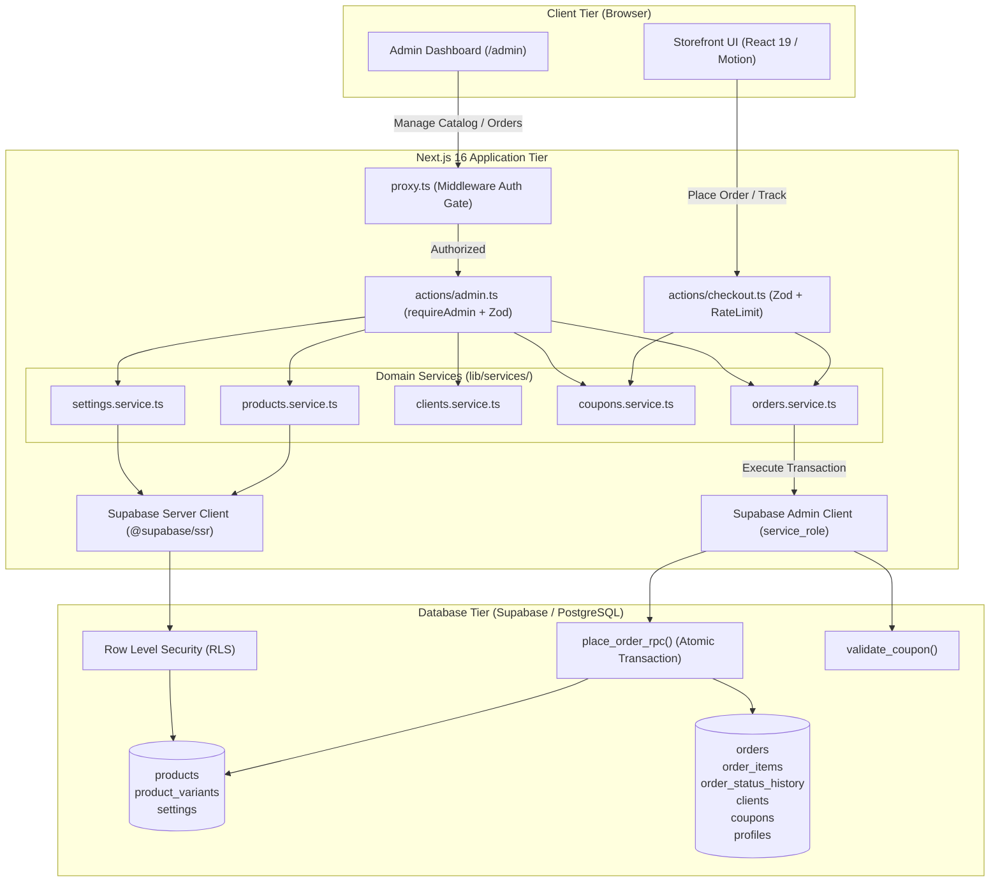

# SAIS STORE — System Architecture Document

**Version:** 2.0 (Production Reconstruction)  
**Status:** Approved  
**Target Platform:** Next.js 16 (App Router) + React 19 + Supabase + Tailwind CSS v4  
**Hosting:** Vercel (Edge / Serverless)

---

## 1. Architectural Philosophy

SAIS STORE is designed for the Moroccan fashion retail market, where high conversion and consumer trust depend on a **frictionless Guest-First Cash on Delivery (COD)** workflow.

### Core Architectural Principles
1. **Zero Client Trust:** All financial calculations (item prices, variant adjustments, storewide discounts, coupon redemptions, delivery fees, and order totals) are computed exclusively on the server and verified inside PostgreSQL transactions. The client provides only selections (slug, variant, quantity, shipping address, coupon code).
2. **Transaction Atomicity:** An order is either created in full (inventory decremented, coupon counted, line items snapped, status history logged, customer record synchronized) or not at all.
3. **Guest-First COD Identity:** Customers do not create passwords or verify emails. The customer identity is established via their normalized Moroccan phone number (`+212...`). Orders can be tracked publicly using phone + reference code or via an unguessable 128-bit tracking token (`/suivre/[token]`).
4. **Strict Role-Based Access Control:** Administrators authenticate via Supabase Auth (email + password). The database enforces admin rights via `public.is_admin()`, verifying JWT `app_metadata.role = 'admin'` and the `profiles` table.
5. **No Service-Role Bypass:** The Service Role key is restricted to server-side operations that require cross-table transactional atomic execution (e.g. `place_order_rpc`). RLS policies are never loosened to compensate for weak query logic.

---

## 2. High-Level Architecture Diagram

---

## 3. Tier Responsibilities

### 3.1. Client Tier (Browser)
- Renders responsive mobile-first UI using Tailwind CSS v4 design tokens.
- Manages client-side cart state (persisted in `localStorage` via `CartProvider.tsx`).
- Performs instant client-side validation using React Hook Form and Zod schemas.
- Handles smooth scrolling (Lenis + GSAP) and entrance animations (Motion) exclusively on the storefront. Admin dashboard is completely decoupled from smooth-scroll libraries.

### 3.2. Server Tier (Next.js App Router)
- **Edge Proxy (`proxy.ts`):** Evaluates Supabase session claims before any `/admin/*` route loads. Unauthenticated requests are redirected to `/admin/login`.
- **Server Actions (`actions/`):**
  - All input received from client forms is parsed using Zod v4 schemas.
  - Server actions are marked `'use server'`.
  - Rate limiting protects public endpoints (e.g., checkout and tracking) against brute force and denial of inventory.
- **Domain Services (`lib/services/`):**
  - Pure, modular TypeScript modules encapsulating business logic.
  - No direct SQL queries in UI components.
  - Clear separation between public queries (using SSR client respecting RLS) and privileged atomic mutations (using admin client).

### 3.3. Database Tier (PostgreSQL / Supabase)
- **Source of Truth:** Products, variants, stock, order records, client directories, and coupons.
- **Atomic Concurrency Control:** `place_order_rpc` acquires row-level locks (`SELECT ... FOR UPDATE`) in deterministic order (by product slug) to prevent deadlocks and overselling during simultaneous checkouts.
- **RLS Boundary:** Zero public exposure of orders, order items, clients, or coupons. Public reads are restricted to active products and store settings.

---

## 4. Key Architectural Patterns

### 4.1. The Backward-Compatible Facade Pattern
To reconstruct the backend without destabilizing the dozens of existing UI pages and components:
- Domain services (`products.service.ts`, `orders.service.ts`, etc.) contain the clean, modern implementations.
- `lib/store.ts` and `lib/products.ts` serve as lightweight typed facades that delegate directly to domain services.
- Zero changes are required in existing storefront views, ensuring 100% visual and functional stability.

### 4.2. Secure Guest Order Tracking
Public order tracking implements a dual-mode mechanism:
1. **Token Tracking (`/suivre/[token]`):** The order contains a cryptographically random UUID (`tracking_token`). Whoever possesses this token can view only that specific order's status and item details.
2. **Phone Verification (`/suivre`):** Requires both the normalized Moroccan phone number (`+212...`) and the order reference (`SAIS-XXXXXXXX`). Query matches both fields via a dedicated PostgreSQL function.
