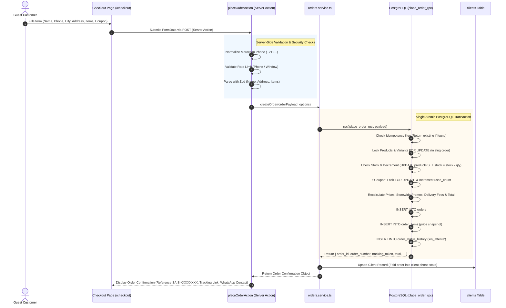
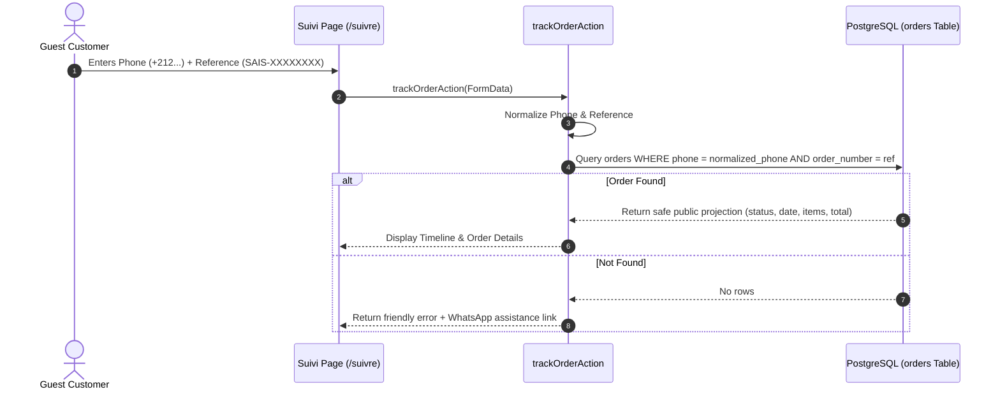
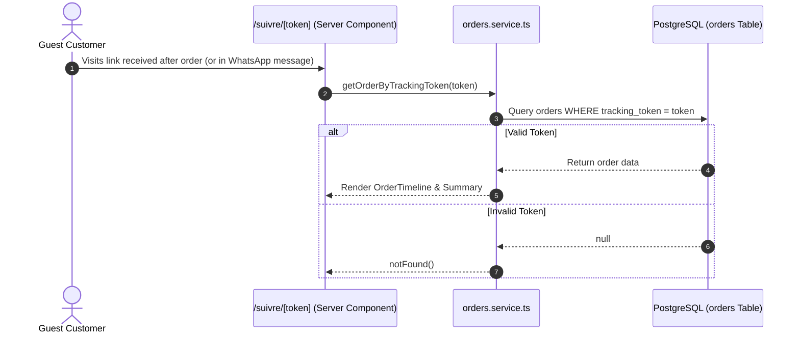
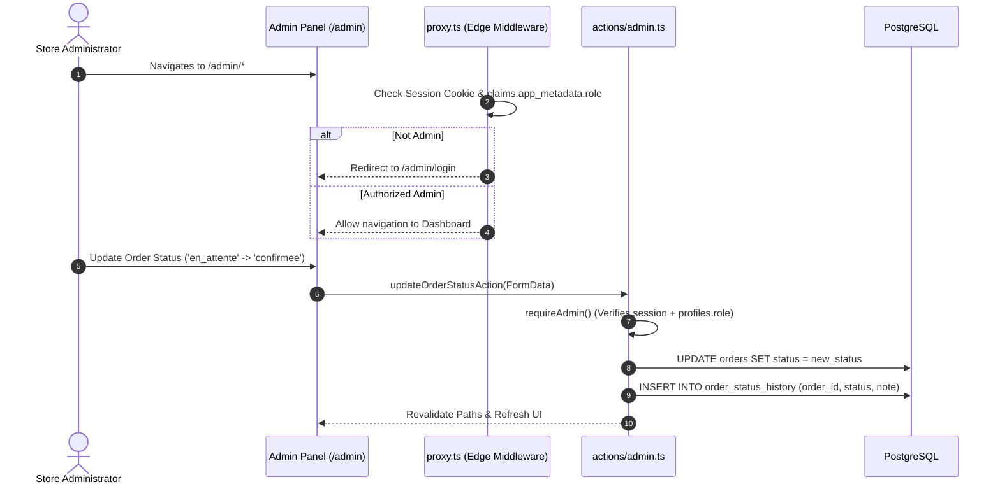

# SAIS STORE — Data Flow & Purchase Lifecycle

**Version:** 2.0  
**Updated:** November 21, 2026

---

## 1. The Guest Checkout Lifecycle (COD)

---

## 2. Public Order Tracking Data Flow

---

## 3. Direct Unguessable Token Tracking (`/suivre/[token]`)

---

## 4. Admin Management Flow

