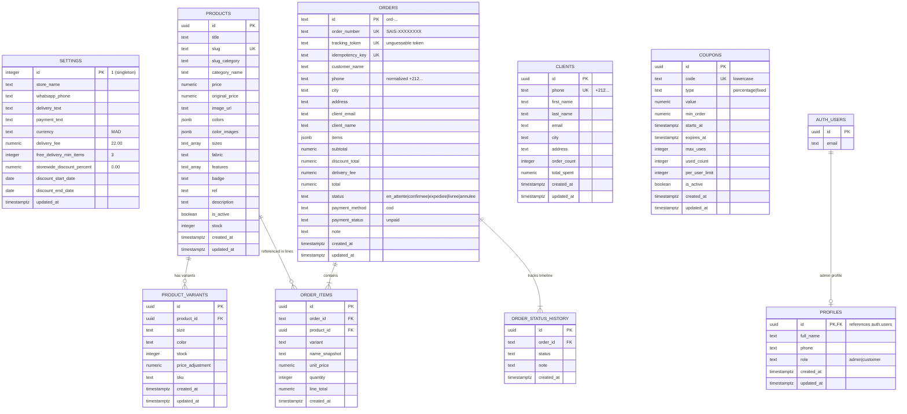

# SAIS STORE — Entity Relationship Diagram (ERD)

**Version:** 2.0 (Production Canonical Schema)  
**Database:** PostgreSQL 15+ (Supabase)

---

## 1. Visual Entity Relationship Diagram

---

## 2. Key Relationship Rules

1. **`PRODUCTS` → `PRODUCT_VARIANTS`:** `ON DELETE CASCADE`. If a product is deleted, its size/color variants are purged.
2. **`ORDERS` → `ORDER_ITEMS`:** `ON DELETE CASCADE`. If an order is purged, its line item snapshots are removed.
3. **`ORDERS` → `ORDER_STATUS_HISTORY`:** `ON DELETE CASCADE`. Tracks timestamped state transitions for the order timeline.
4. **`CLIENTS`:** De-normalized guest CRM directory indexed by unique phone number. Each order updates the client's `order_count`, `total_spent`, and latest address.
5. **`AUTH_USERS` → `PROFILES`:** 1-to-1 extension of Supabase Auth users. Admin role verification derives from `profiles.role = 'admin'` or JWT claims.
